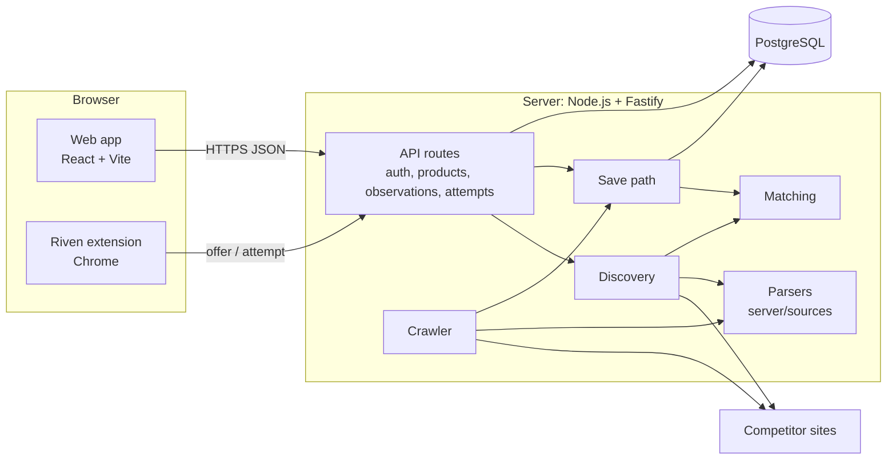
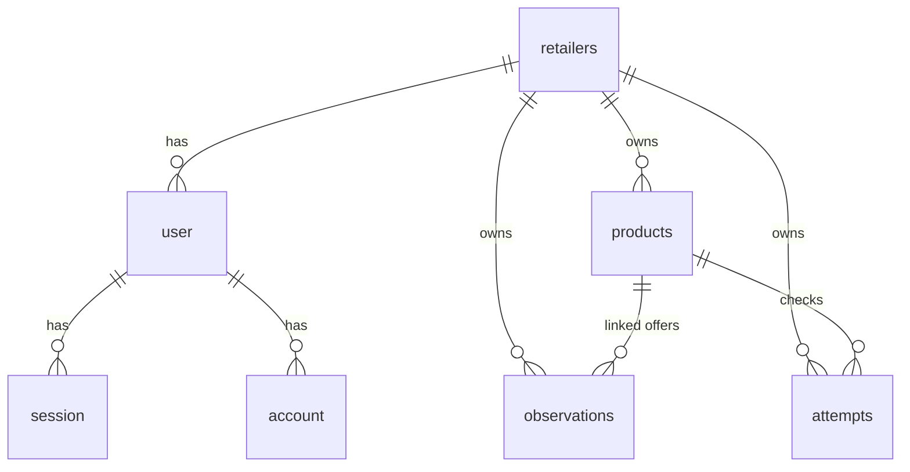

# Software design document (SDD)

**Riven** · Version 1.0 · 4 November 2026 · Status: approved by the client, 4 Nov 2026

| Version | Date | Change |
| --- | --- | --- |
| 1.0 | 4 Nov 2026 | First SDD. Collects the design from the core manual, `api.md`, `database.md` and the code on `main` at `05d6100`, and adds the 4 Nov collection decisions. Approved by the client at the 4 Nov demo. |

## 1. Purpose and scope

This document describes how Riven is built. What Riven must do is in the [SRS](requirements.md); requirement IDs (FR, NFR) refer to it. Endpoint details are in [api.md](api.md) and database setup in [database.md](database.md).

Each part is marked **Built** (in code on `main`) or **Planned** (decided, not yet built).

## 2. Architecture

Riven is one application: a web app, an API server with its collection code, one PostgreSQL database, and a browser extension.



| Component | Responsibility | Code |
| --- | --- | --- |
| Web app | Screens; calls the API; never fetches competitor sites | `web/` (app), `web/landing/` (public page) |
| API | Validates requests, derives the retailer from the session, reads and writes the database | `server/app.ts`, `products.ts`, `observations.ts`, `auth.ts` |
| Discovery | Searches a platform for candidate offers for a product (up to 5) | `server/discovery.ts` |
| Crawler | Re-checks known offers on sites that allow server requests | `server/crawler.ts`, `scripts/run-crawler.ts` |
| Parsers | Turn one site's page into an offer; no database or UI code | `server/sources/` |
| Matching | Decides `confirmed`, `unverified` or `mismatch` | `server/matching.ts` |
| Save path | The one place offers are written, for every fetcher | `server/save-observation.ts` |
| Extension | Reads the Amazon page the retailer is viewing and sends the offer | `extension/` |
| Database | Accounts, products, observations, attempts | `server/data/migrations/` |

## 3. Collection pipeline

### 3.1 Current (Built)

Two fetchers feed one save path.

| Fetcher | Trigger | Fetch | Parse |
| --- | --- | --- | --- |
| Server crawler | Fixed interval for all products (`CRAWLER_INTERVAL_MS`, off when 0), or `POST /api/v1/crawl` | Plain `fetch`, 15-second timeout | Server, `server/sources/amazon.ts` |
| Extension | The retailer opens the extension on an Amazon product page | The retailer's own browser | Extension, using the same `amazon.ts` parser |

Every check writes an attempt (`ok`, `blocked` or `failed`) in the same transaction as any observation. An observation is written only when the offer validates. Earlier observations are never changed by a failure.

### 3.2 Target (Planned, decided 4 Nov 2026)

```text
Fetch (two ways in)                One pipeline (everything else)
─────────────────────              ─────────────────────────────────────────────
Server crawler: fetches URL  ─┐
                              ├─→ site rules → validate → match → save → alert
Extension: sends page HTML  ──┘   (one parser, one attempts table, one save path)
```

1. **Site rules instead of one parser per site.** Each platform is described as data: an ordered list of rules per field (JSON-LD first, then CSS selectors, then a text pattern). One shared extractor reads any page with any site's rules and records which rule matched (NFR-10).
2. **The extension sends the page, not the parsed offer.** All parsing moves to the server, so both fetchers behave the same. The server parses the page, then discards it; raw pages are never stored (NFR-12).
3. **Check interval per product.** A default schedule, which each product can override or pause (FR-05). Runs as background jobs outside web requests.
4. **Fetch escalation.** Plain HTTP first; a headless browser only for pages that need JavaScript.
5. **Validation guards.** Suspect prices are recorded as failed attempts (NFR-05); unchanged values within 6 hours are not stored again (FR-06); a large price gap blocks automatic confirmation (FR-04).
6. **Failed pages become fixtures.** A page that could not be parsed is saved, with personal data removed, as a test fixture (NFR-11).

## 4. Data design



| Table | Holds | Key rules |
| --- | --- | --- |
| `retailers` | One workspace (tenant) | No passwords stored here |
| `user`, `session`, `account`, `verification` | Better Auth sign-in data | Generated by Better Auth; `user.retailerId` links a user to a workspace |
| `products` | What the retailer tracks: name, brand, optional ASIN | `retailer_id` required |
| `observations` | One collected offer value: price, currency, availability, seller, source, match status, time, fetcher (`extension` or `crawler`) | Price is decimal text or NULL; a price needs a currency; only `unverified` without a product |
| `attempts` | One collection try: source, status, reason, time | Status is `ok`, `blocked` or `failed` |

- **An offer is not a separate table.** An offer is the series of observations with the same product, source and ASIN; its latest row gives the current value and match status.
- **Tenant safety.** Every table has `retailer_id`; composite foreign keys stop linking one retailer's rows to another's product. Queries always filter by the session's retailer (NFR-01).
- **Removing a product** deletes its observations and attempts in one transaction, so its history goes with it.

## 5. API design

All routes are under `/api/v1`, return JSON and need a signed-in session unless marked public. Errors use `{ "code": "...", "message": "..." }`. Full request and response details: [api.md](api.md).

| Area | Method and path | Purpose |
| --- | --- | --- |
| Auth | `POST /auth/sign-in`, `POST /auth/sign-out`, `GET /auth/me` | Session handling (Better Auth) |
| Products | `GET /products`, `POST /products`, `DELETE /products/:id` | List, add, remove a product |
| Discovery | `POST /products/:id/discover` | Find competitor offers for a product |
| Observations | `GET /observations`, `POST /observations` | Read offers; save an offer from the extension |
| Matching | `PATCH /observations/:id` | Retailer confirms or rejects an offer |
| Offers | `DELETE /observations/:id/listing` | Remove a competitor offer from a product |
| Attempts | `GET /attempts`, `POST /attempts` | Read attempts; record an extension attempt |
| Collection | `POST /crawl` | Run the crawler now |
| Legacy (public) | `GET /demo-observation`, `GET /practice-observation` | Sprint 1 checkpoint routes; candidates for removal |

## 6. UI design

| Screen | Purpose | Code |
| --- | --- | --- |
| Landing page | Public product page at `/` | `web/landing/` |
| Sign-in | Retailer signs in | `web/screens/SignIn.tsx` |
| Search | List and search the retailer's tracked products | `web/screens/Search.tsx` |
| Add product | Create a product | `web/screens/AddProduct.tsx` |
| Competitors | Offers for a product with match status; confirm, reject, remove | `web/screens/Competitors.tsx` |
| Detail | One product: offers and price history | `web/screens/Detail.tsx` |

Visual direction (colours, type, components) is in [PRODUCT.md](../PRODUCT.md#brand-commitments).

## 7. Design rules

1. The retailer always comes from the verified session, never from the request body (NFR-01).
2. Every collection try writes an attempt; an observation only when it validates (FR-06).
3. Money is a decimal string plus a currency; never a floating-point number. Missing price is NULL, not zero (NFR-05).
4. Matching order: identifier, then conflicting details, then title. A title alone never confirms (FR-04).
5. Parsers only parse. They do not write the database or know about the UI (NFR-07).
6. The web app reads the database through the API and never contacts a competitor site.

## 8. Deployment

- **Live:** https://riven.sbs on a VPS (Ubuntu 24.04) with Docker Compose; Caddy serves HTTPS and proxies to the app. Files: `deploy/compose.yaml`, `deploy/Caddyfile`. Steps: [setup](setup.md#live-deployment).
- **One process** serves the built web app and the API from the same address.
- **CI:** GitHub Actions installs dependencies, typechecks and runs the tests on each pull request (`.github/workflows/ci.yml`).

## 9. Decision log

Format: date · decision · why · trade-off.

| Date | Decision | Why | Trade-off |
| --- | --- | --- | --- |
| 30 Sep 2026 | TypeScript, React + Vite, Fastify, PostgreSQL, Better Auth | One language end to end; small, well-documented tools | Fewer built-in features than a full framework |
| 10 Oct 2026 | Riven lists competitors automatically; the retailer confirms or rejects | Client decision; retailers should not need to know every competitor | Discovery can find wrong products, so matching must stay cautious |
| 10 Oct 2026 | Matching order: identifier, conflict check, title as `unverified`, retailer decides | Titles alone are unreliable | More offers wait for the retailer |
| 12 Oct 2026 | Amazon pages come through a Riven browser extension | Amazon refused server requests in the live check | Amazon updates only when the retailer views a page |
| 24 Oct 2026 | Plain `fetch` for Amazon instead of Crawlee | Crawlee's browser-like headers got non-HTML replies | No built-in queue or retries; handled in Riven's own code |
| 24 Oct 2026 | One save path for both fetchers | Offers behave the same whichever way they arrive | — |
| 24 Oct 2026 | Live site on a VPS behind Caddy | Low cost; automatic HTTPS | Team maintains the server |
| 4 Nov 2026 | One pipeline, two fetchers; extension sends the page, server parses (section 3.2) | Simplest design that still works on sites that block servers | Pages must be handled carefully for privacy |
| 4 Nov 2026 | Site rules as data, fetch escalation, per-product schedule, validation guards | A common pattern in price trackers; adding a site needs no code change | More upfront work than one parser per site |
| 4 Nov 2026 | Collection code is written by the team; no third-party tracker code is copied | Keeps Riven free of other projects' licence terms | Riven writes its own implementation |
| 4 Nov 2026 | AI-assisted page reading and regional proxies are optional, off by default | Useful for awkward pages and regional prices | Paid services need client agreement |
| 4 Nov 2026 | Client approved SRS v1.0 at the demo, including per-product check intervals and the MoSCoW priorities | Client review of the live app and documents | Default interval value still to set |

A decision is revisited when a test, the client or a site's behaviour shows it no longer works.
