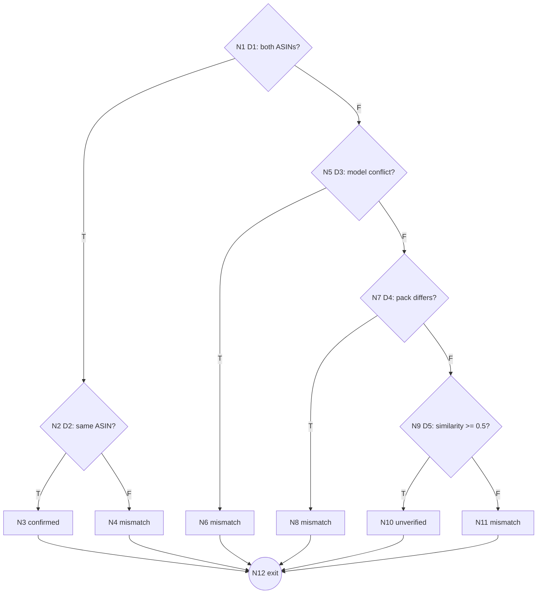

# EC4206 Role B: white-box, TDD, BDD and coverage

Owner: Sanjeew (Role B, per the roster in `strategy.md`)
Updated: 21 November 2026 (Asia/Colombo)
Branch: `qa/ec4206-b` (no Jira key; Jira omitted for this workstream, as recorded in `ledger.md`)
Base: `7a1eb88` (current `main`). It differs from the planning baseline `29af237` only in Role A documents; `server/`, `shared/`, `extension/`, `package.json` and `vitest.config.ts` are identical.

## Ledger

| Task | Status | Artifacts | Evidence |
|---|---|---|---|
| B1 Baseline and select function | Done | Section 1 | `evidence/b1-baseline.txt` |
| B2 White-box analysis | Done | Section 2 | This document; tests `WB-001`..`WB-010` |
| B3 Unit tests, TDD, coverage | Done; owner review pending | Section 3, `server/matching.ts`, `server/matching.test.ts`, `vitest.config.ts` | `evidence/b3-tdd-red.txt`, `b3-tdd-green.txt`, `b3-tdd-refactor.txt`, `b3-coverage.txt` |
| B4 BDD scenarios | Done; team agreement on Cucumber.js pending | Section 4, `server/features/`, `cucumber.json` | `evidence/b4-bdd-run.txt` |

Pushed commit, pull request and CI run: not yet observed.

## 1. B1 Baseline and function selection

### Baseline (15 November 2026)

| Item | Value |
|---|---|
| Commit | `29af23787b9de37d65f3ed00d30297e4f67185b3` |
| Environment | Arch Linux, Node 26.13.1, npm 12.2.2 (the repo asks for Node 24 / npm 11; `npm ci` warned `EBADENGINE`, all checks still ran) |
| `npm ci` | Installed; 22 audit findings (1 low, 17 moderate, 2 high, 2 critical) handed to Role D, not fixed here |
| `npm run typecheck` | Passed (web, server, extension) |
| `npm test` | 12 files passed, 3 skipped; 76 tests passed, 23 skipped |
| Skipped | Database-dependent tests (for example `auth.integration.test.ts`, `data/seed.integration.test.ts`), which skip without a database URL. Not run here; Role A ran them serially (26/26) on 19 November. |

### Selected function: `matchOffer()` in `server/matching.ts`

**Why this function.** It is the rule behind FR-04 (Matching, Must, Built). It has five decisions, three of which are compound conditions, so the complexity calculation and coverage are worth doing. It is pure (no database, no session, no network), so every path can be driven by a unit test. A wrong answer has a visible cost: a `mismatch` hides a real competitor offer, and a wrong `confirmed` would put another product's price into the retailer's comparison.

**Current behaviour (built, not planned).** Rules run in order and the first one that decides wins:

1. Both sides have an ASIN: same ASIN gives `confirmed`, different ASIN gives `mismatch`.
2. Both titles contain model numbers and none is shared: `mismatch`.
3. Pack sizes differ (`2-pack`, `pack of 3`, `twin pack`, `x 4`): `mismatch`.
4. Title similarity of brand plus name against the offer title is at least 0.5: `unverified`; otherwise `mismatch`.

A title match alone never gives `confirmed`. The FR-04 price-gap guard (an offer more than 40% away cannot be confirmed automatically) is **Planned** and is not in the code, so it is not tested as built.

### Code map

| Item | Finding |
|---|---|
| Function | `server/matching.ts:48` `matchOffer(product, offer)` returning `confirmed`, `unverified` or `mismatch` |
| Helpers (same file) | `modelTokens`, `packSize`, `titleSimilarity`, `fullName` |
| Direct caller | `server/discovery.ts:105`, which drops discovery candidates that are a `mismatch` |
| Via `linkOffer()` | `server/save-observation.ts:43` `buildObservation()`, the single save path for the extension and the crawler; `server/products.ts:94` when a product is added |
| Input guarantees | ASINs reach it uppercase: `server/products.ts:14` and `shared/collected-observation.ts:7` enforce `^[A-Z0-9]{10}$`. Extension offers always carry an ASIN, so title rules apply when the retailer's product has no ASIN (added by name). |
| Existing tests | `server/matching.test.ts`: 6 `matchOffer`, 1 `modelTokens`, 4 `packSize`, 3 `linkOffer` |

End-to-end path: the extension reads a viewed Amazon page → `POST` to the API, which checks the session → the server parses the page → `ExtensionOfferSchema` → `saveObservation()` loads only this retailer's products → `buildObservation()` → `linkOffer()` → `matchOffer()` → an observation row with `product_id` and `match_status`. The retailer sees `unverified` offers on the product page and confirms or rejects them (FR-04, test plan M4).

## 2. B2 White-box analysis of `matchOffer()`

Code as delivered on this branch (`server/matching.ts:48-66`).

### Control-flow graph

| Node | Line | Statement |
|---|---|---|
| N1 | 50 | Entry; decision D1 `product.asin && offer.asin` |
| N2 | 51 | Decision D2 `product.asin === offer.asin` |
| N3 | 51 | `return "confirmed"` |
| N4 | 51 | `return "mismatch"` (different ASIN) |
| N5 | 55-57 | Compute model tokens; decision D3 `productModels.size > 0 && offerModels.size > 0 && !shared` |
| N6 | 58 | `return "mismatch"` (model conflict) |
| N7 | 60 | Decision D4 `packSize(product) !== packSize(offer)` |
| N8 | 61 | `return "mismatch"` (pack conflict) |
| N9 | 65 | Decision D5 `titleSimilarity(...) >= 0.5` |
| N10 | 65 | `return "unverified"` |
| N11 | 65 | `return "mismatch"` (dissimilar title) |
| N12 | 66 | Exit |

Edges (16): N1→N2, N1→N5, N2→N3, N2→N4, N3→N12, N4→N12, N5→N6, N5→N7, N6→N12, N7→N8, N7→N9, N8→N12, N9→N10, N9→N11, N10→N12, N11→N12.

### Cyclomatic complexity

| Method | Calculation | V(G) |
|---|---|---|
| Edges and nodes | E − N + 2 = 16 − 12 + 2 | **6** |
| Predicate nodes | P + 1 = 5 + 1 | **6** |
| Regions | 5 bounded + 1 outer | **6** |
| Counting each `&&` condition (strict, as ESLint `complexity` does) | 8 atomic conditions + 1 | 9 |

The `.some()` callback on line 57 is a separate function and is not counted. Before the B3 refactor, `matchOffer` also held the brand ternary that is now `fullName()`, so at the planning baseline it was V(G) = 7 (10 by the strict count).

### Basis paths and test cases

| Path | Nodes | Test (repository name) | Input summary | Expected | Actual |
|---|---|---|---|---|---|
| P1 | N1 N2 N3 N12 | `WB-001` "confirms the same ASIN" | both ASIN `B004YAVF8I` | `confirmed` | Pass |
| P2 | N1 N2 N4 N12 | `WB-002` "rules out a different ASIN" | `B004YAVF8I` vs `B07W6JN8V8` | `mismatch` | Pass |
| P3 | N1 N5 N6 N12 | `WB-003` "rules out a different model number" | M185 vs M190 | `mismatch` | Pass |
| P4 | N1 N5 N7 N8 N12 | `WB-004` "rules out a different pack size" | single vs `2-Pack` | `mismatch` | Pass |
| P5 | N1 N5 N7 N9 N10 N12 | `WB-005` "keeps a similar title as unverified, never confirmed" | same M185 title, no ASIN | `unverified` | Pass |
| P6 | N1 N5 N7 N9 N11 N12 | `WB-006` "rules out an unrelated title" | mouse vs coin purse | `mismatch` | Pass |

All six basis paths, and so every statement and both outcomes of every decision, were already covered by the existing tests at baseline. The tests below were added for condition outcomes, the defect, and the line that coverage showed unreached.

| ID | Test | Purpose | Path | Expected | Actual |
|---|---|---|---|---|---|
| `WB-007` | "falls through to the title rules when only the product has an ASIN" | D1 with `product.asin` true and `offer.asin` false | P5 | `unverified` | Pass (characterisation; passed on first run) |
| `WB-008` | "keeps the same monitor unverified when one title states its resolution" and `packSize` rows `1920 x 1080`, `70 x 140 cm`, `x 4` | Defect: a dimension read as a pack size (TDD in B3) | P5 | `unverified`; pack sizes 1, 1, 4 | Failed before the fix, passes after |
| `WB-009` | "skips the model rule when the product name has no model number" | D3 with `productModels.size > 0` false | P5 | `unverified` | Pass (characterisation) |
| `WB-010` | "rules out an offer whose title has no words" | `titleSimilarity` empty-set return (`matching.ts:43`), the only line coverage showed unreached | P6 | `mismatch` | Pass (coverage-driven) |

### Condition outcomes

| Decision | Condition outcomes | Covered by |
|---|---|---|
| D1 | (T,T) / (T,F) / (F,–) | WB-001, WB-002 / WB-007 / WB-003..006 |
| D2 | T / F | WB-001 / WB-002 |
| D3 | first F / first T, second F / all T (conflict) / third F (shared model) | WB-009 / WB-006 / WB-003 / WB-005 |
| D4 | T / F | WB-004 / WB-005 |
| D5 | T / F | WB-005 / WB-006, WB-010 |

### Risky or uncovered paths (handoff to Role D)

| Ref | Observation | Evidence | Disposition |
|---|---|---|---|
| R1 | **Defect, fixed here:** `packSize()` read `1920 x 1080` as a 1080-pack and `70 x 140 cm` as a 140-pack, so the same monitor was ruled `mismatch` and a real competitor offer was hidden. Breaks FR-04 (no actual pack conflict). | `evidence/b3-tdd-red.txt` | Fixed on this branch. Role D to log a real issue ID; none is invented here. |
| R2 | Title similarity divides by the shorter title, so a one-word offer title such as `Mouse` scores 1.0 against any mouse product and becomes `unverified`. FR-04 still holds (never `confirmed`), but the retailer gets weak candidates. | Probe on 21 Nov: `matchOffer(mouse, { productName: "Mouse" })` returned `unverified` | Not changed; recommendation for Role D. |
| R3 | ASIN comparison is case-sensitive. It is safe only because the two schemas listed in the code map uppercase ASINs; a new channel that skips them would turn the same ASIN into `mismatch`. | Probe on 21 Nov: lowercase same ASIN returned `mismatch` | Dependency recorded; no current defect. |
| R4 | FR-04 price-gap guard is Planned, not built. | `docs/requirements.md` FR-04 | No passing claim. |
| R5 | The database part of `saveObservation()` (a tracked listing keeps the retailer's decision) is exercised only by database tests, which skip in the unit run. | `evidence/b3-coverage.txt` (`save-observation.ts` 26.66% statements in the unit run) | Needs the integration environment (Role C). |
| R6 | After the fix, an `x N` straight after a number is never a pack count, so a title such as `Batteries 10 x 4` reads as 1. | Reasoning, not observed in data | Accepted limit; `2-pack` and `pack of N` still work. |

## 3. B3 Unit tests, TDD and coverage

### TDD sequence (21 November 2026, base `7a1eb88`)

| Step | Change | Command | Result | Evidence |
|---|---|---|---|---|
| Red | Added WB-008 tests only (`server/matching.ts` unchanged) | `npx vitest run server/matching.test.ts` | 3 failed, 15 passed: expected `unverified`, got `mismatch`; expected 1, got 1080; expected 1, got 140 | `evidence/b3-tdd-red.txt` |
| Green | `packSize()`: the `x N` rule now ignores an `x` that follows a number (`(?<!\d\s*)\bx\s?(\d+)\b`) | same | 18 passed | `evidence/b3-tdd-green.txt` |
| Refactor | Extracted the duplicated brand-plus-name expression from `matchOffer` and `linkOffer` into `fullName()`; no behaviour change | `npm run typecheck:server && npm test` | Typecheck passed; 12 files passed, 3 skipped; 80 tests passed, 23 skipped | `evidence/b3-tdd-refactor.txt` |

Then WB-007, WB-009 and WB-010 were added. They passed on their first run, so they are characterisation and coverage tests, not TDD.

### Coverage

| Item | Value |
|---|---|
| Tool | `@vitest/coverage-v8` 5.0.3 (dev dependency added; matches Vitest 5.0.3) |
| Command | `npm run test:coverage` (whole suite); `npx vitest run server/matching.test.ts --coverage --coverage.include=server/matching.ts --coverage.reportsDirectory=coverage/matching` (function under test) |
| Denominator | All non-test TypeScript in `server/`, `shared/`, `extension/src/` (`vitest.config.ts`) |
| Exclusions | `**/*.test.ts`, `**/fixtures/**`, `server/features/**` (BDD steps) |
| Output | Terminal text, `coverage/coverage-summary.json`, `coverage/index.html` (folder is git-ignored; numbers are copied into the evidence file) |

| Scope | Statements | Branches | Run |
|---|---|---|---|
| `server/matching.ts`, before WB-010 | 97.43% | 97.14% | Line 43 unreached |
| `server/matching.ts`, final | **100%** | **100% (35/35)** | 21 tests passed |
| Whole unit suite, final | **32.25%** | **41.88% (209/499)** | 83 passed, 23 skipped |

The whole-suite figure is low because database tests skip without PostgreSQL. It is a unit-only number and must not be reported as the system's coverage. A run with the integration environment would give a higher figure; that run has not been done.

## 4. B4 BDD scenarios

| Item | Value |
|---|---|
| Feature | `server/features/matching.feature` |
| Steps | `server/features/steps/matching.steps.ts` (TypeScript) |
| Tool | `@cucumber/cucumber` 13.3.0 (dev dependency added), loaded through `tsx`; config `cucumber.json` |
| Command | `npm run test:bdd` |
| Requirement | FR-04 (NFR-05 for the kept price string and currency) |
| Role A cases | `TC-OFFER-001` (scenario 1), `TC-OFFER-002` and `TC-OFFER-003` (scenario 2) |
| Result, 21 Nov | 4 scenarios passed, 17 steps passed (`evidence/b4-bdd-run.txt`) |
| Negative check | The same feature with a title-only row expecting `confirmed` failed at the `Then` step with an assertion error, so the steps do check the outcome |

Scenarios:

1. **An offer with my product's ASIN is confirmed and keeps its price.**
2. **A title alone never confirms an offer** (outline): similar title → linked and `unverified`; different model → not linked; 2-pack → not linked.

The steps validate each offer with the API's `ExtensionOfferSchema`, derive the source from the page URL with `sourceOf()`, and run `buildObservation()`, the same rules the save path uses.

**Limitations.** No browser, HTTP route, session or PostgreSQL is exercised. The step that keeps a retailer's earlier decision for a tracked listing is not covered (R5). Offers are synthetic and prove nothing about live Amazon pages. An offer linked to no product is stored as `unverified` with no product; this is current behaviour, not a new rule. Adding Cucumber.js needs team agreement (guide B4); if the team declines, `server/features/` and the two dev dependencies can be removed without affecting anything else.

## 5. Handoffs

| To | Item |
|---|---|
| A (Ilmam) | Map `WB-001`..`WB-010` and both BDD scenarios to `TC-OFFER-001`..`003` in `traceability.md` (Role B column). |
| C (Hirukshanan) | Stable commands for CI: `npm run test:coverage`, `npm run test:bdd`. Coverage output: `coverage/coverage-summary.json`. |
| D (Dilsan) | Coverage figures and denominator above; risks R1–R6; a real issue ID for R1; the 22 `npm audit` findings from the baseline. |

## 6. AI assistance

The analysis, tests, `packSize` fix, refactor, BDD files and this document were drafted by an AI assistant (Claude Code) on 21 November 2026 at the Role B owner's request. Every listed result comes from a command that was actually run, and its output is saved under `evidence/`. Under `AGENTS.md`, the owner reviews this work and must be able to explain it before the pull request is merged.
